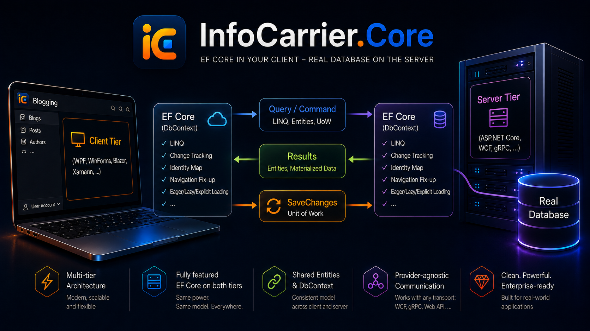

<div align="center">



[](https://github.com/azabluda/InfoCarrier.Core/actions/workflows/build.yml)
[](https://www.nuget.org/packages/InfoCarrier.Core)
[](license.txt)

[Published documentation](https://azabluda.github.io/InfoCarrier.Core/) ·
[Development setup](website/docs/getting-started/installation.md) ·
[Samples](samples/) · [Contributing](CONTRIBUTING.md)

</div>

InfoCarrier.Core is an Entity Framework Core provider for client applications that use a database
through an application server. The client uses LINQ and change tracking without a database driver
or connection string. The server runs queries and saves with its own database provider.

This branch contains version 11 development code. It currently targets .NET 10 and Entity Framework
Core 10. The latest published release identified by this checkout is 10.3.0.
Use the [development installation guide](website/docs/getting-started/installation.md) for these APIs.
Stable package installation alone does not provide the version 11 setup shown below.

## Basic usage

Both applications share a context and entity model. On the client:

```csharp
using var http = new HttpClient();
IInfoCarrierClient client = InfoCarrierClient.Create(http, o =>
    o.WithEndpoint("https://your-app-server/infocarrier"));

var options = new DbContextOptionsBuilder<ShopContext>().UseInfoCarrier(client).Options;
await using var context = new ShopContext(options);

var recent = await context.Orders
    .Where(o => o.Customer!.Country == "Germany")
    .OrderByDescending(o => o.PlacedOn)
    .Take(20)
    .ToListAsync();
```

The server registers its real database context, calls `AddInfoCarrierServer<ShopContext>()`,
and maps `app.MapInfoCarrier()`.
The [complete SQLite tutorial](website/docs/getting-started/first-app.md) supplies imports,
project setup, model code, seed data, and a save followed by a fresh read.

## Features and limits

Queries, saves, relationship loading, transactions, savepoints, and supported bulk operations run
through the server. Asynchronous non-tracking queries can stream results.
Supported final projections can run locally. Filtering, ordering, grouping, joins, and equality
must run on the server unless the application explicitly chooses local execution.

HTTP is included. Custom transports implement both `Send` and `SendAsync`.
The server's database provider determines which queries it can translate.
Read [limitations](website/docs/overview/limitations.md),
[security](website/docs/operations/security.md), and
[client/server compatibility](website/docs/reference/compatibility.md) before adopting.

## Credits

Built on [Entity Framework Core](https://github.com/dotnet/efcore).

[InfoCarrier.Core 1.0 to 3.1](https://github.com/azabluda/InfoCarrier.Core/tree/release/3.1),
by [on/off it-solutions gmbh](http://www.onoff-it-solutions.info), used
[Remote.Linq](https://github.com/6bee/Remote.Linq) and
[aqua-core](https://github.com/6bee/aqua-core) by Christof Senn.
The current implementation uses its own serializer.

MIT, Copyright (c) Alexander Zabluda. See [license.txt](license.txt).

## Support

For questions or bugs, [open an issue](https://github.com/azabluda/InfoCarrier.Core/issues/new).
Report vulnerabilities through a
[private advisory](https://github.com/azabluda/InfoCarrier.Core/security/advisories/new).
See [SECURITY.md](SECURITY.md) for scope and supported versions.
