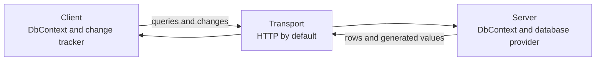

# InfoCarrier.Core

InfoCarrier.Core is an Entity Framework Core provider for client applications that access a database
through an application server. The client uses LINQ, change tracking, and `SaveChanges`.
The database provider and connection string stay on the server.

These are version 11 development instructions. The checkout currently uses Entity Framework Core 10.
For published version 10.3, use the [public documentation](https://azabluda.github.io/InfoCarrier.Core/).

## Start here

- [Install the development source](getting-started/installation.md).
- [Build a complete client and server](getting-started/first-app.md) using SQLite.
- [Run the Northwind samples](getting-started/samples.md).
- [Read the limitations](overview/limitations.md) before choosing the product.

## How it works

Both applications share the entity classes and context model.
The client sends a description of the query or changed entities.
The server executes that work through its own Entity Framework Core context.

Filters, ordering, grouping, and joins must run on the server.
If they cannot, the query fails. Supported final result construction can run on the client.
Choose local processing explicitly with `AsEnumerable` after reducing the data on the server.
See [query execution](applications/querying.md).

## What you can build

Use ordinary queries, tracked saves, relationship loading, transactions and savepoints.
Bulk updates and deletes run on the server where its provider supports them.
Asynchronous non-tracking queries can [stream results](applications/streaming.md).

Relational models, inheritance mappings, table and entity splitting, provider functions,
complex types, and custom values have dedicated support.
The underlying database provider still decides which operations it can translate.
See [limitations](overview/limitations.md) and [shared settings](applications/configuration/shared.md).

HTTP is included. Other protocols require a [custom transport and host](extending/transports.md).
Browser clients use asynchronous operations and have [platform restrictions](getting-started/blazor-webassembly.md).

## Before deployment

The server accepts client-composed queries and writes.
Protect the endpoint, enforce permissions on the server, set resource limits, and plan transaction recovery.
Start with [security](operations/security.md), then [tenant isolation](operations/tenants.md),
[diagnostics](operations/diagnostics.md), and [compatibility](reference/compatibility.md).

## Feedback

For questions or problems, [open an issue](https://github.com/azabluda/InfoCarrier.Core/issues/new).
