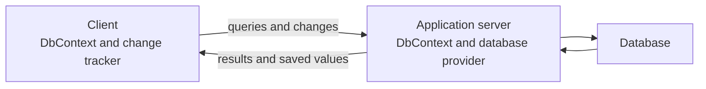

# InfoCarrier.Core

InfoCarrier.Core is an Entity Framework Core provider that lets your .NET client query and save
through one generic server endpoint.
Use LINQ and change tracking instead of writing a controller for every entity or query.

## Write the query your screen needs

On the client, use a context configured for your application server:

```csharp
await using var db = await contexts.CreateDbContextAsync();

var orders = await db.Orders
    .Where(o => o.Customer!.Country == "Germany")
    .OrderByDescending(o => o.PlacedOn)
    .Take(20)
    .ToListAsync();

if (orders.Count > 0)
{
    orders[0].Freight = 0m;
    await db.SaveChangesAsync();
}
```

The server filters, sorts, and pages the orders. The save sends the tracked change back.
You use the same entity classes and context model on both sides.

On the server, register the context with your database provider, then expose InfoCarrier:

```csharp
builder.Services.AddInfoCarrierServer<ShopContext>();

// After builder.Build():
app.MapInfoCarrier();
```

That endpoint handles queries and saves for the shared model.
You still control authentication and data permissions on the server.

[Install the NuGet packages](getting-started/installation.md), then
[build the complete SQLite example](getting-started/first-app.md).
The tutorial supplies the model, imports, client setup, database seed, and expected output.

## How it fits



The client has no database driver or connection string.
The server executes the work using its own Entity Framework Core provider.

## Explore

- [Choosing InfoCarrier](overview/choosing-infocarrier.md): application fit and responsibilities.
- [Queries](applications/querying.md), [saves](applications/saving.md), and [relationships](applications/related-data.md).
- [Transactions](applications/transactions.md) and [browser clients](applications/blazor-webassembly.md).
- [The Northwind example](applications/northwind-sample.md): a larger browser and console application.
- [Deployment security](operations/security.md): authentication, access rules, and resource controls.


## Feedback

For questions or problems, [open an issue](https://github.com/azabluda/InfoCarrier.Core/issues/new).
