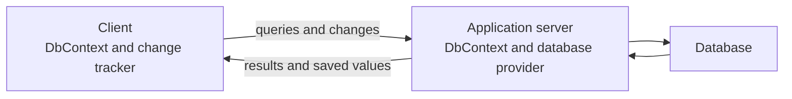

# InfoCarrier.Core

InfoCarrier.Core is an Entity Framework Core provider for applications that access a database
through an application server. Write LINQ queries and use change tracking in a desktop, browser,
or console client. The server runs the database operations.

Both applications share their entity classes and context model.
The client needs no database driver or connection string.

## How the applications work together

For example, a client can ask for the latest orders, edit one, and call `SaveChangesAsync`.
InfoCarrier sends the query and changes to the server over HTTP.
The server executes them through its own Entity Framework Core context.

## Try it

[Build your first client and server](getting-started/first-app.md) to read and update data using SQLite.
The tutorial supplies the model, database setup, seed data, and expected output.

Want to see an existing application first?
[Run the Northwind sample](getting-started/samples.md) in a browser or console.

## Decide whether it fits

Read [Choosing InfoCarrier](overview/choosing-infocarrier.md) for the application architecture,
common capabilities, and deployment responsibilities.

These pages describe version 11 development code, currently using Entity Framework Core 10.
The [public documentation](https://azabluda.github.io/InfoCarrier.Core/) describes published version 10.3.

## Continue building

After the tutorial, learn to [query](applications/querying.md), [save changes](applications/saving.md),
[load related data](applications/related-data.md), and [use transactions](applications/transactions.md).
Each guide builds on the same Shop model.

## Feedback

For questions or problems, [open an issue](https://github.com/azabluda/InfoCarrier.Core/issues/new).
